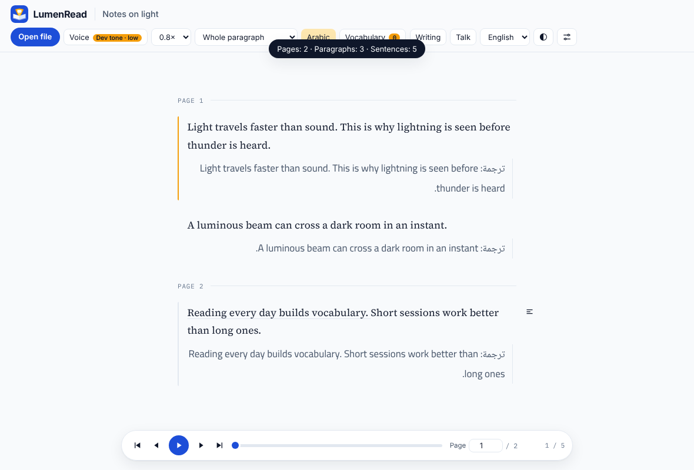
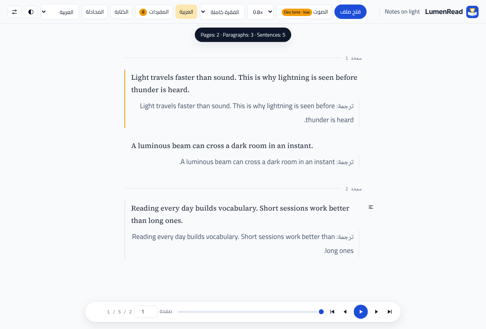
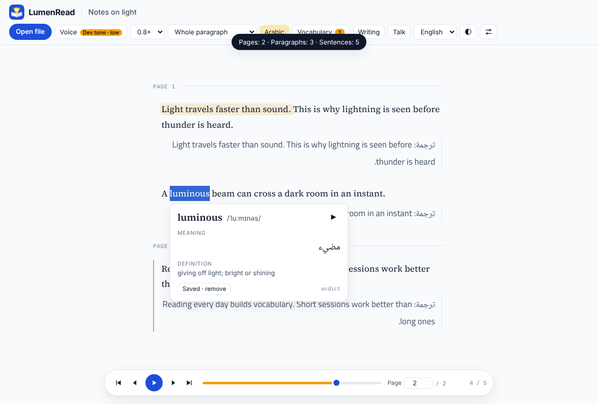
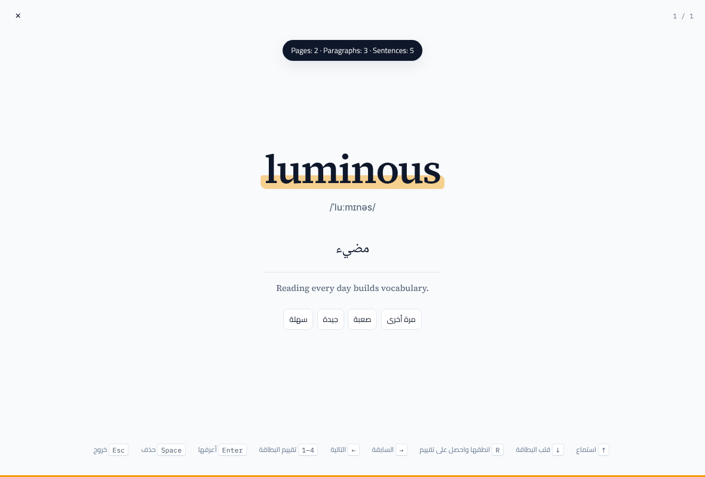

<p align="center"></p>

# LumenRead

**Read. Listen. Speak. Understand.** · اقرأ. استمع. تحدث. افهم.

*Learn English by listening, speaking, and reading.* · *تعلّم الإنجليزية بالاستماع والتحدث والقراءة.*

LumenRead is a local-first English-learning app with a fully bilingual interface (English and
Arabic, with right-to-left layout) and built-in English→Arabic translation as a learning aid.
Open any English document, hear it read slowly with the spoken sentence highlighted, tap a word for
its IPA, definition and Arabic meaning, practise speaking with a tutor, and write a retelling that is
corrected in English with optional Arabic hints. Everything runs on your own computer; after the
one-time model download nothing is sent anywhere. It ships as a **web interface served locally** and
as an **Android app** (a native shell, see [Android](#android-app)).

> **Upstream.** LumenRead is a fork of [LLMersion-1](https://github.com/QM378/LLMersion), the
> reference implementation of the LLMersion scheme (paper below). Code is MIT; the original copyright
> notice is kept in `LICENSE`. See `NOTICE.md`.

| English interface | Arabic interface (RTL), Arabic translation under each paragraph |
|---|---|
|  |  |

| Word tap: IPA, definition, Arabic gloss | Flashcard in the Arabic UI |
|---|---|
|  |  |

## Features

- **Bilingual UI** — `web/i18n/en.json` and `ar.json` hold every visible string (a test fails if a key
  is missing in either). Language: System / English / العربية, in the header and in Settings, saved
  across sessions. `<html dir lang>` is set by one layout controller, CSS uses logical properties
  only, directional icons mirror, and **document text keeps its own direction**: English stays LTR
  inside the Arabic UI.
- **Translation aid, independent of the UI language** — Arabic (default) or Chinese under each
  paragraph, toggle per session. `opus-mt-en-ar` by default; NLLB or any Ollama model selectable.
- **Listening and reading** — speed 0.5×–1.5× (default 0.8×), sentence highlighting synced with the
  voice, tap any word for sound + IPA + English definition + Arabic gloss, saved to a vocabulary with
  spaced-repetition flashcards (English front, optional Arabic back).
- **PDF import** — file picker or drag-and-drop, per-page extraction with page numbers and
  jump-to-page, optional OCR for scanned PDFs (Tesseract `eng`, optionally `ara`) with progress and
  graceful fallback; extracted text and translations are cached per document hash.
- **Speaking** — free talk, a topic, or the open document. The tutor speaks English; grammar cards give
  a one-sentence English rule; pronunciation feedback is shown with the sounds that differ. Each card
  has an opt-in **Show Arabic hint** button.
- **Writing** — corrected English with changes marked, errors explained in English, vocabulary check,
  optional Arabic hint for the top errors.
- **Privacy** — no account, no telemetry, no external CDN (fonts are bundled). The optional curator is
  off by default.

## Install and run

Requires Python 3.10+. First run downloads models (a few GB).

**Windows**
```bat
setup-windows.bat
start-windows.bat
```
**macOS**
```bash
./setup-mac.command
./start-mac.command
```
**Linux**
```bash
python3 -m venv .venv && . .venv/bin/activate
pip install torch                                   # or the CUDA build, see docs/INSTALL.md
pip install -r requirements/core.txt -r requirements/voice.txt -r requirements/translate.txt -r requirements/ocr.txt
sudo apt install tesseract-ocr tesseract-ocr-eng tesseract-ocr-ara   # optional: scanned PDFs
python -m server.main
```
Open the printed address (default `http://127.0.0.1:8848`). Try it with no models at all:
`PR_DEV=1 python -m server.main` (tone-generator voice).

### Test
```bash
pip install -r requirements/core.txt -r requirements/ocr.txt -r requirements/dev.txt
python -m playwright install chromium     # browser acceptance tests (optional)
python -m pytest tests -q                 # all platforms
node --test tests/js/layout.test.mjs      # JS unit tests alone
```
On Windows use `py -m pytest tests -q`. If Playwright's Chromium is not installed, the browser tests
look for `LUMEN_CHROMIUM` or a system Chromium and are skipped otherwise.

## Android app

`android/` is a native Android app (Java, `WebView`, no third-party dependencies). The models are too
large to run inside a phone app, so the app is the **front end for your own LumenRead server**: start
the server on your computer (`PR_HOST=0.0.0.0 PR_TOKEN=secret python -m server.main`), enter its
address in the app once, and use LumenRead on the phone: microphone, PDF picker, Arabic RTL and all.

- Build: open `android/` in Android Studio, or `cd android && gradle assembleDebug`; CI builds it in
  `.github/workflows/android.yml` and uploads the APK.
- Microphone: Android only allows the microphone on `https://` or `http://localhost`. Use
  `adb reverse tcp:8848 tcp:8848` and the address `http://localhost:8848`, or put the server behind
  HTTPS. Reading, translation, vocabulary and writing work over plain `http://` on your network.
- **Status:** the project and its Java source were written but **not compiled or run** in the
  environment this fork was prepared in (no Android SDK was reachable). Expect to fix small build
  issues on first build.

## Configuration

Environment variables (all optional):

| Variable | Meaning |
|---|---|
| `PR_MT_MODEL_AR`, `PR_MT_BACKEND_AR` | Arabic translation model / backend (default `Helsinki-NLP/opus-mt-en-ar`) |
| `PR_MT_MODEL_ZH`, `PR_MT_BACKEND_ZH` | Chinese equivalents (`opus-mt-en-zh` stays available) |
| `PR_TTS_SPEED` | default reading speed (0.8) |
| `PR_TESSERACT`, `PR_OCR_DPI` | Tesseract binary path, OCR resolution |
| `PR_PIPER_AR_DIR` | folder for optional Arabic Piper voices |
| `PR_HOST`, `PR_PORT`, `PR_TOKEN` | serving; set a token when binding beyond localhost |
| `PR_DATA` | data directory (existing `ReadingDesk` installs keep their data) |

User settings (UI language, theme, translation target, speed, OCR) are in `settings.json` in the data
directory and in the Settings panel.

## Architecture

```
server/        FastAPI: routes, settings, cache (SQLite), loaders (PDF/OCR), hints, prompts
  mt/          translation plugins: ollama, hf (zh), opus_ar (Arabic)   — one file each
  engines/     TTS plugins: kokoro, piper, piper_ar (optional Arabic), edge, dev …
talk/          conversation module (tutor, coach, scoring)
prompts/       every model prompt as a text file; *.hint_ar.txt / *.hint_zh.txt are the hint variants
web/           index.html, style.css (logical properties), app.js, js/{layout,i18n,header,flashcards,settings}.js
web/i18n/      en.json, ar.json       web/brand/  logo, favicon, icons       web/fonts/  bundled fonts
android/       WebView shell app
tests/         pytest + node + Playwright acceptance
```
Everything new is a plugin, a config entry, a prompt file or an i18n resource; the upstream plugin
architecture is unchanged and Chinese remains supported (`translation target = Chinese`).

## Known limitations

- Word glosses for single words come from machine translation of the bare word, so ambiguous words
  can be wrong; the IPA and the English definition need the optional ECDICT dictionary
  (`tools/build_ecdict.py`), otherwise only the gloss (and an LLM-written definition when Ollama runs).
- opus-mt-en-ar is a small model: fine for study, not publication quality. NLLB is better but
  CC-BY-NC.
- The tutor, corrections, writing feedback and Arabic hints need Ollama; without it those buttons
  explain that.
- The reader is English-first: Arabic documents are shown (RTL) but not read aloud unless you add an
  Arabic voice plugin; Arabic voices are not used for the English reading.
- Scanned-PDF OCR quality depends on the scan. Mixed Arabic/English pages need the `ara` pack.
- Numerals are Latin digits in both languages by design.
- Reader keyboard shortcuts (←/→) follow the English text and are not mirrored; flashcard navigation
  keys are mirrored.
- The Android app needs a running server and was not built in this environment (see above).

Extension points: add a UI language by adding `web/i18n/<code>.json` (the parity test checks it) and
listing it in `layout.js`/`i18n.js`; add a translator in `server/mt/`, a voice in `server/engines/`, a
document format in `server/loaders.py`, or a prompt in `prompts/`. See `docs/MODELS.md` and
`docs/INSTALL.md`.

## Citing

If you use LumenRead, please cite the LLMersion paper it is built on:

```bibtex
@article{guo2026llmersion,
  title={LLMersion: A Local-First AI Agent Framework for Low-Cost Home Language Learning toward Educational Equity},
  author={Guo, Qiming and Tang, Jinwen and Huang, Xingran and Lin, Hung-Yu and Zhong, Yafu and Zhuang, Xiatian},
  journal={arXiv preprint arXiv:2609.29672},
  year={2026}
}
```

## License

MIT (code), including the upstream LLMersion notice. Model weights and fonts keep their own licenses:
see `docs/MODELS.md`.
